 

 

 

## &nbsp;I &nbsp;·&nbsp; Philosophy

> *Most apps don't fail on the landing page. They fail at the login, the edge case, the 10,001st request.*

I'm a full stack developer who starts at the **server** — secure auth flows, request validation, rate limiting and honest error handling — then builds the interface on top of something that can carry weight. My AI work is **type-safe by construction**: model output is forced into a typed schema and validated, never string-parsed and hoped for.

<table>
<tr>
<td width="33%" valign="top">

**◆ Security-first** 
Rotating refresh tokens, HTTP-only cookies, server-side token blacklisting, cycle-guarded data trees.

</td>
<td width="33%" valign="top">

**◆ Deterministic AI** 
Gemini locked to JSON schemas. Resource links matched server-side — never hallucinated.

</td>
<td width="33%" valign="top">

**◆ Product-minded** 
Every project is live, deployed and solves a real problem. No chatbot wrappers.

</td>
</tr>
</table>

📍 New Delhi &nbsp;·&nbsp; 🎯 Seeking full-time **SDE / Full Stack** roles on backend-leaning, product-focused teams &nbsp;·&nbsp; 🧠 Into system design & developer tooling

 

## &nbsp;II &nbsp;·&nbsp; Selected Work

<table>
<tr>
<td width="50%" valign="top">

### PrepStack
**SDE interview-prep platform** 
DSA tracking, CS fundamentals, AI project generation and resume guidance — one workspace.

- Refresh-token rotation, HTTP-only cookies
- Reusable Zod `validate(schema)` middleware + rate limiting
- Gemini output locked to a typed JSON shape
- Code-split React 19 UI, lazy-loaded routes

`React 19` `Express 5` `MongoDB` `Gemini` `Zod` `JWT`

[**Live ↗**](https://prepstack-ss.vercel.app/) &nbsp;·&nbsp; [Source](https://github.com/SahilSameer18/prepstack)

</td>
<td width="50%" valign="top">

### SkillBridgeAI
**AI skill-gap analyzer** 
Resume + job description in. Gap report, roadmap, curated resources and interview questions out.

- Prisma/PostgreSQL: `User → InterviewReport → {Questions, SkillGaps, PreparationPlan}`, cascading deletes
- Word-boundary + fuzzy skill matching, zero AI-made links
- Server-side token blacklisting on logout
- One-click PDF export via Puppeteer

`React 19` `Express 5` `PostgreSQL` `Prisma` `Gemini` `Puppeteer`

[**Live ↗**](https://skillbridgeai-s.vercel.app/) &nbsp;·&nbsp; [Source](https://github.com/SahilSameer18/skillbridgeAI)

</td>
</tr>
<tr>
<td width="50%" valign="top">

### VaultDrive
**Cloud storage, done properly** 
Soft-delete trash with restore fallbacks, nested folders with cycle guards, public share links, presigned direct uploads.

- JWT auth with token rotation
- Server-side search, multi-field sort, pagination

`React` `Express` `PostgreSQL` `Prisma` `Cloudinary`

[**Live ↗**](https://vaultdrive-s.vercel.app) &nbsp;·&nbsp; [Source](https://github.com/SahilSameer18/vaultDrive)

</td>
<td width="50%" valign="top">

### mindMesh
**The conversation becomes the canvas** 
AI-native collaborative workspace that turns spoken dialogue into living knowledge maps in real time.

- Real-time collaboration over sockets
- Speech → structured, interactive graph

`React` `Node` `Socket.IO` `AI`

[**Live ↗**](https://mindmesh-s.vercel.app/) &nbsp;·&nbsp; [Source](https://github.com/SahilSameer18/mindMesh)

</td>
</tr>
<tr>
<td colspan="2" valign="top">

### InForge
**Event-driven Gmail safety & automation platform** — deterministic, zero-persistence email-body architecture: message content is processed, never stored. &nbsp; `Node 20` `Express 5` `React 19` `Tailwind v4` &nbsp;·&nbsp; [Source](https://github.com/SahilSameer18/InForge)

</td>
</tr>
</table>

 

## &nbsp;III &nbsp;·&nbsp; Instruments

| | |
|:--|:--|
| **Backend** |      |
| **Frontend** |    |
| **Data** |      |
| **AI & APIs** |   |
| **Ship** |      |

 

## &nbsp;IV &nbsp;·&nbsp; The Ledger

 

Currently building & refining **PrepStack** and **SkillBridgeAI**

  

**Let's build something that holds up.** &nbsp;[sahilsameer.dev18@gmail.com](mailto:sahilsameer.dev18@gmail.com)

