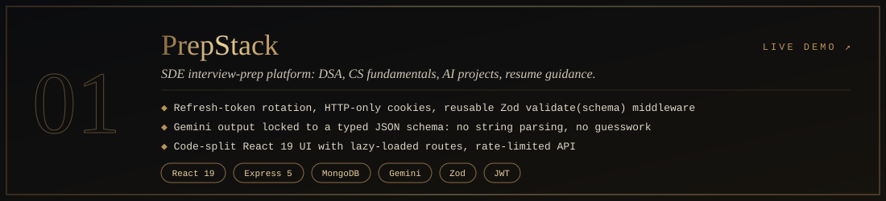
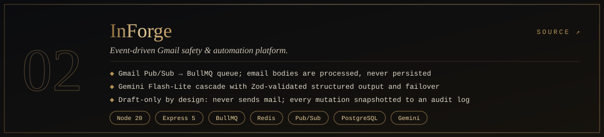
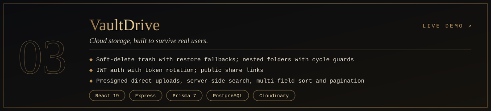
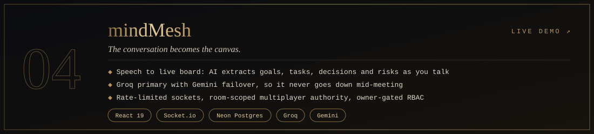

 

 

## Hi, I'm Sahil

I'm a full stack engineer who starts at the **server**: auth flows, request validation, rate limiting and honest error handling. Then I build the interface on top of something that can carry weight.

> *Most apps don't fail on the landing page. They fail at the login, the edge case, the 10,001st request.*

📍 New Delhi, India
🎯 Looking for **SDE / Full Stack** roles on backend-leaning, product-focused teams
🎓 <!-- TODO: B.Tech / degree, college, graduation year -->
🧠 Interested in system design and developer tooling

 

## What I care about

| | |
|:--|:--|
| 🔐 **Security by default** | Rotating refresh tokens, HTTP-only cookies, server-side token blacklisting, cycle-guarded tree structures. |
| 🧱 **Layered validation** | Zod schemas at the edge, typed data in the middle, and rate limits in front of both. |
| 🤖 **Schema-validated AI** | Model output is forced into a JSON schema and validated. Resource links are matched server-side, never generated by the model. |
| 🚀 **Shipped, not stashed** | Every project below is deployed and has a working link. |

 

## Selected work

**PrepStack** · AI-assisted interview preparation
Gemini output is constrained to JSON schemas, and recommended resources are matched against a server-side catalogue instead of being invented by the model.
<!-- TODO: one metric, e.g. number of users, tests, or endpoints -->
`Node.js` `Express` `PostgreSQL` `Prisma` `Gemini` `React` `TypeScript`
[Live demo](https://prepstack-ss.vercel.app/) · [Source](https://github.com/SahilSameer18/prepstack)

 

**InForge** · Backend-focused platform
<!-- TODO: one sentence on what InForge does and its hardest engineering problem -->
Production-style API with authentication, validation and rate limiting. The free-tier host sleeps when idle, so the first request can take up to a minute.
`Node.js` `Express` `JWT` `Zod` `Redis`
[System health](https://inforge-fgdb.onrender.com/api/health) · [Source](https://github.com/SahilSameer18/InForge)

 

**VaultDrive** · Secure file storage
Refresh-token rotation with server-side blacklisting, plus cycle-guarded folder trees so a move operation can never make a folder its own ancestor.
`Node.js` `Express` `MongoDB` `Mongoose` `JWT` `React`
[Live demo](https://vaultdrive-s.vercel.app) · [Source](https://github.com/SahilSameer18/vaultDrive)

 

**mindMesh** · Connected-ideas workspace
<!-- TODO: one sentence on what mindMesh does and its hardest engineering problem -->
Real-time features built on Socket.IO with a typed API layer.
`Node.js` `Socket.IO` `React` `TypeScript` `Tailwind`
[Live demo](https://mindmesh-s.vercel.app/) · [Source](https://github.com/SahilSameer18/mindMesh)

 

## Toolkit

| | |
|:--|:--|
| **Backend** | Node.js · Express · REST · JWT · Zod · Socket.IO |
| **Frontend** | React · TypeScript · Tailwind CSS |
| **Data** | PostgreSQL · MongoDB · Redis · Prisma · Mongoose |
| **AI** | Gemini (structured output) · Groq |
| **APIs** | Google Places |
| **Ship** | Git · GitHub · Vercel · Render · Neon · Postman |

 

## Currently

- Building and refining **PrepStack** and **InForge**
- Going deeper on system design: caching, queues, and failure modes

 

**Let's build something that holds up.**
[sahilsameer.dev18@gmail.com](mailto:sahilsameer.dev18@gmail.com)

